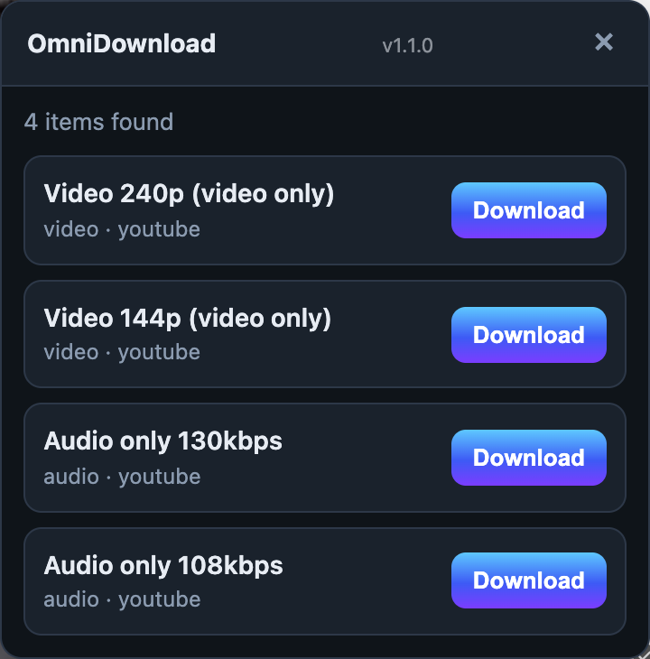

<p align="center">
  
</p>

<h1 align="center">OmniDownload</h1>

<p align="center">
  A Chrome extension that saves images and videos from the page you are already on.<br />
  YouTube · Instagram · Reddit · X · Imgur · and any site with direct media.
</p>

<p align="center">
  
</p>

---

## Features

- **One panel, every site.** A small button in the corner of the page lists everything downloadable, largest and best first.
- **Real quality choices.** YouTube streams up to 4K, X video bitrates, full-size Instagram carousels, Reddit galleries.
- **Resolves what the page really shows.** Uses each site's own data and APIs rather than guessing from thumbnails.
- **Works on unknown sites.** Falls back to Open Graph tags, structured data, `<video>` sources and large images.
- **Streaming video too.** Pages that play through a blob (HLS) show one entry per resolution and save as a single MP4.
- **Streams to disk.** Downloads go through the browser, so large files are not held in memory.
- **No accounts, no servers.** Everything runs locally in your browser.

## Install

Requires Node 20+ and Chrome 120+.

```bash
npm install
npm run build
```

Then in Chrome:

1. Open `chrome://extensions` and turn on **Developer mode**.
2. Choose **Load unpacked** and select this folder.
3. Reload the extension after any change to `src/` (`npm run watch` rebuilds automatically).

## Usage

1. Open a post, reel, thread or video page.
2. Click the **OmniDownload** button in the bottom-right corner, or the toolbar icon.
3. Pick an item and press **Download**.

## Supported sites

| Site | How it is read | Notes |
|------|----------------|-------|
| **YouTube** | Innertube `player` API using the `ios` client, falling back to the page's player data | Video and audio are separate files; signature-protected formats are skipped |
| **Instagram** | Web `/api/v1/media/{id}/info/` from your own session | Requires being logged in |
| **Reddit** | Post `.json` with your session, falling back to the rendered post | Includes the separate audio track of `v.redd.it` videos |
| **X / Twitter** | Public syndication endpoint, then guest-token GraphQL | |
| **Imgur** | `api.imgur.com` post API | Albums, galleries and direct image links |
| **Streaming video (HLS)** | Finds `.m3u8` playlists in the page, lists each resolution, joins the segments into one MP4 | Plain, unencrypted streams only; encrypted and live streams are refused |
| **Other sites** | Open Graph, JSON-LD, `<video>`, `srcset` images, media links | Skips icons and tiny images |

Signed media URLs expire. If a download fails, refresh the page and try again.

## How it works

```
 page ──► content script ──► site extractor ──► media items ──► panel
                │                  │
                │                  └─ background worker (X, Imgur APIs)
                └─ download request ──► background worker ──► chrome.downloads
```

- The **content script** registers one extractor per site (`src/sites/`) and shows the panel. Extractors for sites that need your login (Instagram, Reddit, YouTube) run inside the page, so requests carry your own cookies.
- The **background worker** handles cross-origin API calls and saves files with `chrome.downloads`.
- Sites with a dedicated extractor skip the generic scraper, unless they return nothing, in which case the generic scraper takes over.

Per-site detail is in [docs/EXTRACTION.md](docs/EXTRACTION.md).

### Adding a site

Create a module and import it from `src/sites/load.js`:

```js
// src/sites/example.js
import { mediaItem } from '../core/media-item.js';
import { registerExtractor } from '../core/registry.js';

registerExtractor({
  id: 'example',
  hostSuffixes: ['example.com'],
  priority: 40,
  extract: (ctx) => [mediaItem({ url: 'https://…', label: 'Clip', kind: 'video' })],
});
```

## Development

```bash
npm run lint       # ESLint
npm test           # parser unit tests, no network
npm run test:api   # X and Imgur extractors against the live APIs
npm run test:e2e   # real Chromium with the built extension (Playwright)
```

`test:e2e` loads the extension in Chromium and checks the panel on a list of real URLs in [`tests/cases.json`](tests/cases.json). It needs `pip install playwright` and `playwright install chromium`.

```
src/
├── background/   service worker, downloads, X and Imgur APIs
├── content/      panel UI and scan loop
├── core/         extractor registry, parsers, shared helpers
└── sites/        one extractor per site
inject/           script that reads the YouTube player from the page's own JS world
tests/            unit, API and end-to-end tests
```

## Credits

Extraction approaches follow the public techniques documented in [yt-dlp](https://github.com/yt-dlp/yt-dlp), [cobalt](https://github.com/imputnet/cobalt) and [gallery-dl](https://github.com/mikf/gallery-dl). OmniDownload is independent and does not bundle or call those tools.

Respect each platform's terms of service and creators' rights when downloading media.
